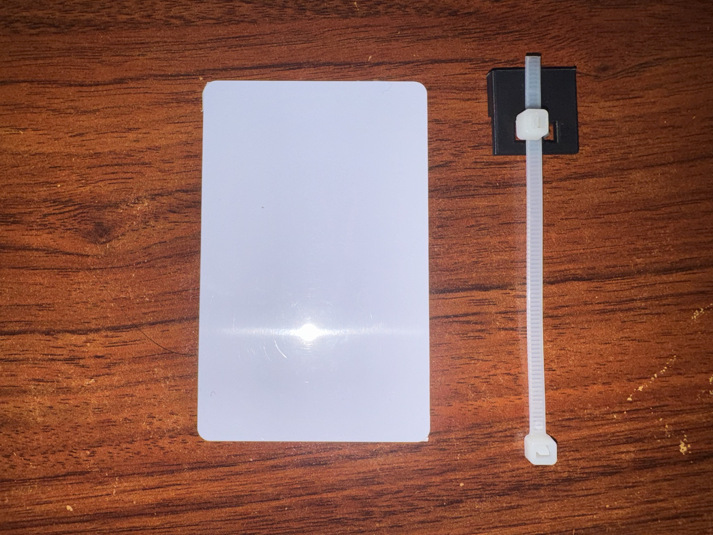
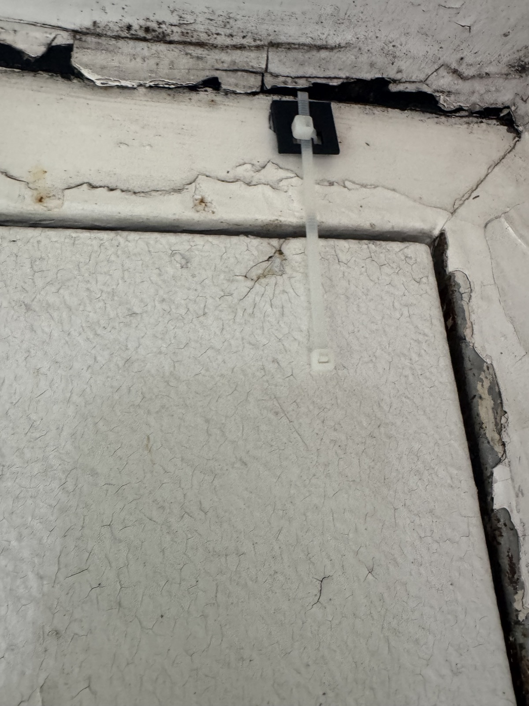
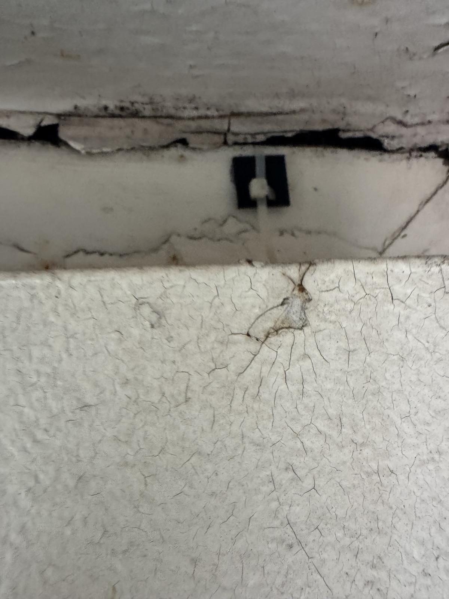
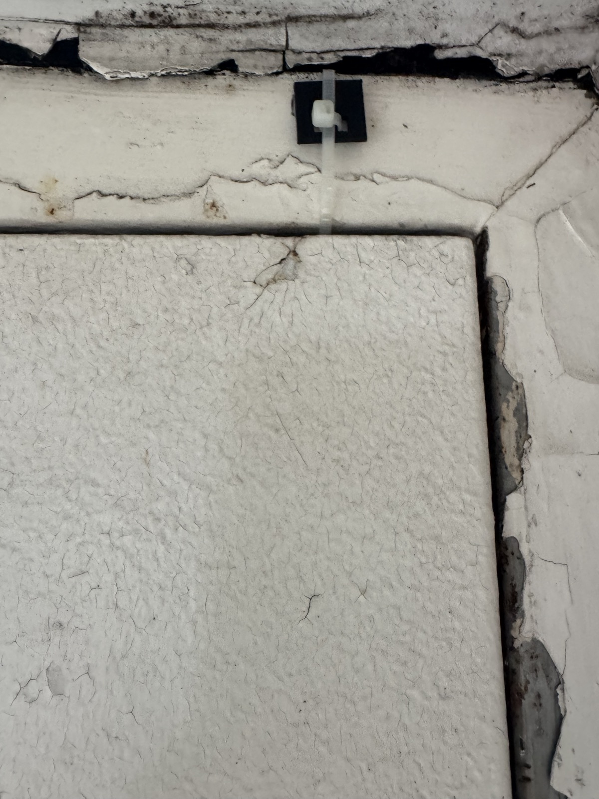

# FOSS Backdoor Botfly

The free and open-source version of the **Backdoor Botfly** — a small (see blank card for scale below), semi-disposable tailgating tool for authorized physical security testing, training, and research.

This is the earlier, community design that anyone can print, build, and modify. A refined version is in development for launch at DEF CON 34.

## How it works

The FOSS Backdoor Botfly is a tailgating tool designed to be used on doors where the hinges are exposed to you. This can be both interior and exterior doors.

Start by peeling off the 3M mounting tape and placing the FOSS Backdoor Botfly on the door frame above the door, on the side opposite the hinges.

As soon as the door opens, while a person is exiting, the FOSS Backdoor Botfly's tail will drop into the space the door previously occupied.

Assuming the person does not see it, as the door closes it will catch the FOSS Backdoor Botfly's tail, which buries itself between the door and door frame, ultimately preventing the door from securely closing.

Due to the nature of this device, we recommend not using it on the main door but rather a smokers' exit, side exit, or back door.

## Contents

**Bill of materials (per unit):** 2 zip ties, 3M VHB tape, and a 3D-printed body printed at 100% infill.

FOSS-BackDoorBotfly.stl 

## Responsible use

This design is intended solely for authorized physical security testing, training, and research. Do not use it to access any space you are not explicitly authorized to enter.

## License

Licensed under the Creative Commons Attribution-NonCommercial 4.0 International License (CC BY-NC 4.0). You may share and adapt the design for non-commercial purposes with attribution. See the LICENSE file or https://creativecommons.org/licenses/by-nc/4.0/ for details.

## Author

Connor Haft — https://connorhaft.com
